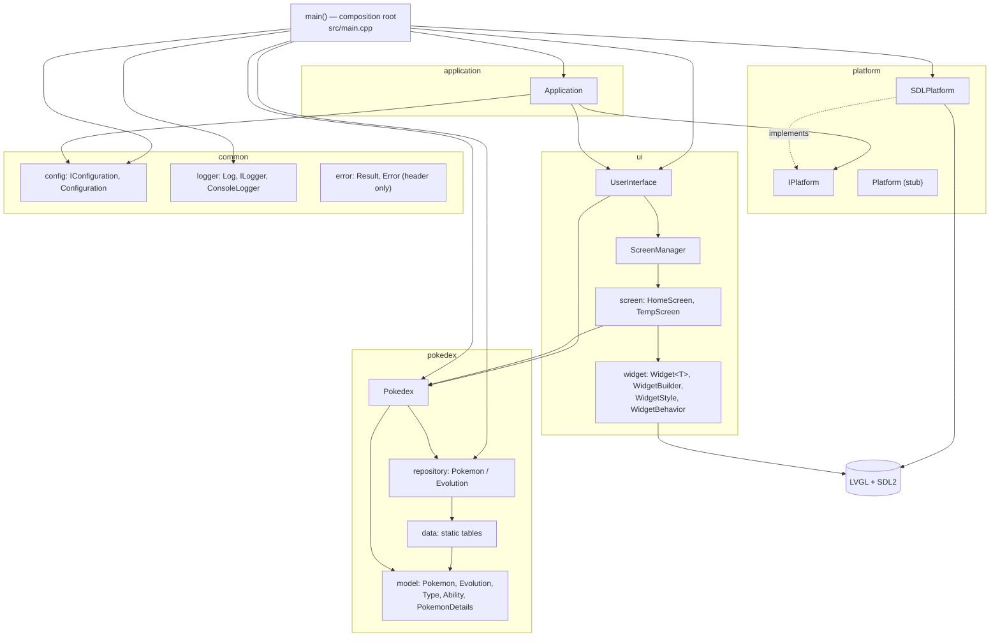
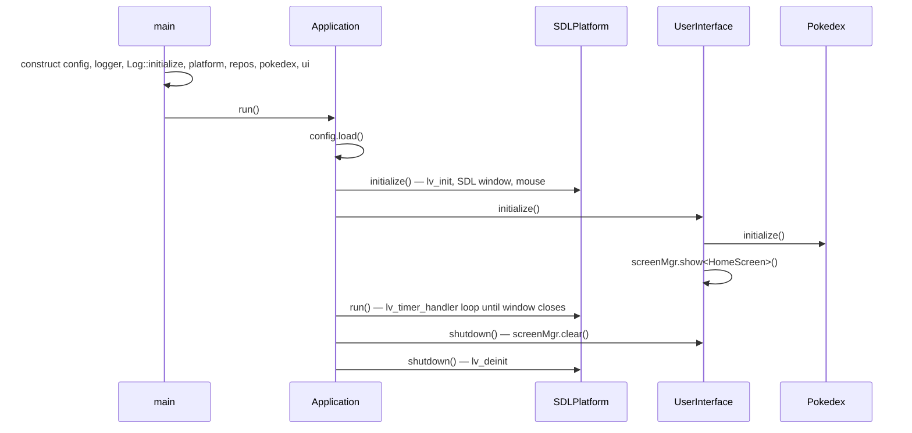

# Project Indigo Architecture

> As of commit `b9b4c65` (branch `main`), 2026-10-31. Source of requirement IDs: [milestones.md](milestones.md).
> Method: read every file under `src/`, all `CMakeLists.txt`, `tests/`, `config/config.json` and `.github/workflows/build.yml`. No build or test run was performed.
>
> **Labels.** **Verified** = seen in code (file cited). **Inferred** = suggested by naming or structure; the basis is stated. "Not found" means the stated search found nothing, not that it cannot exist.

Decisions are recorded in [architecture/decisions/](architecture/decisions/):

| ADR | Title | Status |
|-----|-------|--------|
| [0001](architecture/decisions/0001-composition-root-and-constructor-injection.md) | Composition root and constructor injection | Accepted |
| [0002](architecture/decisions/0002-static-log-facade-exception.md) | Static `Log` facade as the one global-state exception | Accepted |
| [0003](architecture/decisions/0003-screen-navigation-and-lifetime.md) | Screen navigation stack and explicit screen teardown | Proposed |

---

## 1. As-Is

### 1.1 Stack (Verified)

| Item | Value | Source |
|------|-------|--------|
| Languages | C++17 (required), C11 | `CMakeLists.txt` |
| UI toolkit | LVGL 9.5, submodule, configured by `config/lv_conf.h` | `CMakeLists.txt`, `external/` |
| Desktop backend | SDL2 window 800×480, mouse input | `src/platform/SDLPlatform.cpp` |
| Libraries | `fmt`, `nlohmann_json`, Catch2 3 (tests) | `src/CMakeLists.txt`, `src/common/config/CMakeLists.txt`, `tests/CMakeLists.txt` |
| Build | CMake ≥ 3.13, presets, Ninja in CI (Debug and Release) | `CMakePresets.json`, `.github/workflows/build.yml` |

### 1.2 Components (Verified)

The diagram mixes CMake targets, classes and conceptual groupings. Arrows show link or `#include` dependencies where applicable.

`Application` depends on the `IUserInterface` interface, not on `UserInterface` (`src/application/Application.h`); the diagram shows the concrete class for readability.

| Module | Responsibility | Public interface | Evidence |
|--------|----------------|------------------|----------|
| `application` | Startup order, run, shutdown; maps `Result` to an exit code | `Application(IConfiguration&, IPlatform&, IUserInterface&)`, `run()` | `Application.cpp` |
| `platform` | Owns LVGL init, display, input and the event loop | `IPlatform { initialize, shutdown, run }` | `IPlatform.h`, `SDLPlatform.cpp` |
| `ui` | Screen lifecycle (`ScreenManager`), screens, widget layer | `IUserInterface { initialize, shutdown }` | `UserInterface.cpp`, `screens/`, `widgets/` |
| `pokedex` | Domain facade over repositories | `IPokedex { initialize, getPokemonDetails(id) }`, `IPokemonRepository::get`, `IEvolutionRepository::get` | `Pokedex.cpp`, `repository/` |
| `common` | Config (JSON, flattened to dotted keys), logging, `Result`/`Error` | `IConfiguration`, `ILogger`, `Result` | `common/` |

### 1.3 Startup and shutdown (Verified)

### 1.4 Patterns (Verified)

- **Composition root and constructor injection.** `main()` builds every object; collaborators are passed by reference to interfaces (`src/main.cpp`). See ADR-0001.
- **Dependency inversion at module seams.** `IPlatform`, `IUserInterface`, `IPokedex`, `IConfiguration`, `ILogger` and both repository interfaces have one or more implementations; `Pokedex` depends only on the repository interfaces (IND-033).
- **Repository + facade.** `Pokedex::getPokemonDetails` assembles `PokemonDetails` from two repositories (`Pokedex.cpp`). Repositories read compiled-in tables in `pokedex/data/` by linear scan (`PokemonRepository.cpp`).
- **Screen lifecycle.** `IScreen { onCreate, onShow, onHide }`; `ScreenManager::show<T>(args...)` constructs a screen, loads it, and destroys the previous one (`ScreenManager.h`). One screen at a time, no stack.
- **Fluent widget builders.** `WidgetBuilder` returns `Label/Container/Line/Button`, each derived from CRTP `Widget<Derived>` with chainable `pos/align/size/style/...`. `WidgetStyle` wraps `lv_style_t` (non-copyable, non-movable). Styles are applied by pointer, so the screen must own them for as long as the LVGL objects live.
- **UI/backend separation.** LVGL and SDL are used only in `src/ui/`, `src/platform/` and (by class name only) `main.cpp`; `pokedex` and `common` include neither (search: `grep -rl "lvgl\|SDL" src`). This already satisfies the intent of IND-133 for SDL; DRM/evdev do not exist yet.
- **Global logging state.** The only application-wide service pointer is static `Log::_logger` (`Log.cpp`), accepted in ADR-0002. Function-local statics also exist: the data tables in `Pokemons.cpp` and `Evolutions.cpp` (const), `HomeScreen::onCreate`'s point array (IND-109) and `Widget::makeStaticStyle`, which creates a mutable function-static `WidgetStyle` per default style; `Button::defaultStyles` and `Container::defaultStyles` call it (`Button.cpp`, `Container.cpp`). See P11.

### 1.5 Dependency direction (Verified)

`main → application, platform, ui, pokedex, common`; `application → platform (CMake), IUserInterface, IConfiguration`; `ui → pokedex, widget, lvgl`; `pokedex → common/logger`; `platform → lvgl, SDL2`. No cycles found between targets. `pokedex` and `common` have no `#include` of `ui/`, `platform/` or `application/` (search over `src/pokedex src/common src/platform`).

### 1.6 Requirement coverage

| Area | Requirements | State |
|------|--------------|-------|
| Module layout, DI, composition root | IND-009, 015–022 | Met (Verified above) |
| Repositories and `Pokedex` | IND-033 | Met |
| Navigation | IND-044, IND-061, IND-114 | Not met: no stack, no way for a screen to request navigation (P7) |
| List, search, filter, sort | IND-048, 057–059 | Not met: `IPokedex` has only `getPokemonDetails(id)` (P7) |
| Config-driven display size and paths | IND-104, 110, 135 | Not met: values hard-coded (P4) |
| Backend isolation | IND-133 | Met for SDL; selection at configure time (IND-125) not yet |
| Unit-test coverage ≥ 80% non-UI | IND-085 | In progress: only the two repositories are tested (P8) |
| Local database, importer | IND-067–072, 119 | Not started; the repository interfaces are the intended seam (OQ-1, OQ-9) |

---

## 2. Observed problems

Severity: **High** breaks behaviour now · **Medium** will cause a defect or blocks a Must requirement · **Low** hygiene.
Defects already tracked in `milestones.md` are cross-referenced, not duplicated.

| # | Problem | Evidence | Impact | Severity |
|---|---------|----------|--------|----------|
| P1 | **Screen teardown order depends on every subclass remembering a rule.** `IScreen::~IScreen` deletes the LVGL tree, but it runs after derived members (the `WidgetStyle`s) are destroyed, so objects briefly reference freed styles. `HomeScreen` works around it with its own destructor (commit `afe5191`). `TempScreen` owns a `WidgetStyle` and has no such destructor. | `IScreen.h`, `HomeScreen.h`, `TempScreen.h` | Latent use-after-free in `TempScreen` today (not reachable: nothing calls `show<TempScreen>`); every new screen repeats the trap. | Medium |
| P2 | **Failures are dropped at module boundaries.** `IUserInterface::initialize()` and `IPokedex::initialize()` return `bool`, `IPlatform::initialize()` returns `Result`. `Application::initialize` ignores the `bool` from `_ui.initialize()`; `UserInterface::initialize` ignores `_pokedex.initialize()`. | `Application.cpp`, `UserInterface.cpp` | A failed UI or pokedex init still reports success and runs. | Medium |
| P3 | **Initialization ownership is unclear.** `UserInterface` initializes `Pokedex`, which it does not own, while `Application` initializes the other injected modules. | `UserInterface.cpp` | Order and responsibility are hidden in the UI; a second consumer of `IPokedex` would initialize it twice or not at all. | Low |
| P4 | **Configuration is loaded but never used.** No call to `getString/getInt/getBool` exists in `src/` outside `Configuration`. `logging.level`, `ui.theme` and `api.*` in `config/config.json` have no effect; display size is `#define`d; config path is `"config/config.json"` relative to the working directory. | search for `getString\|getInt\|getBool\|_config.` in `src/`; `SDLPlatform.cpp`; `main.cpp` | Blocks IND-104, 110, 135; `ConsoleLogger` has no level filter, so `logging.level` cannot work yet. Related: IND-104, IND-110. | Medium |
| P5 | **`Log` crashes if used before `Log::initialize`.** `Log::trace/debug/...` call `_logger->log` with no null check. | `Log.h`, `Log.cpp` (`_logger = nullptr`) | Any test or tool that exercises code containing `TRACE(...)` (e.g. `Pokedex::initialize`) without initializing `Log` dereferences null. Blocks testing `Application`/`Pokedex` in isolation. | Medium |
| P6 | **Header and CMake dependencies are looser than declared.** `IUserInterface.h` includes `pokedex/IPokedex.h` but does not use it, so `Application` compiles against domain headers. `application`, `platform` and `pokedex` use `LogMacro.h` but do not link `logger`; `IScreen.h` and `ScreenManager.h` use `lv_obj_t` without including `<lvgl.h>` (compiles only because `UserInterface.h` includes `widgets/WidgetStyle.h` first). `application` links `platform` PUBLIC though it needs only the `IPlatform` header. | `IUserInterface.h`; `application/`, `platform/`, `pokedex/CMakeLists.txt`; `IScreen.h` | Works today because static libraries are all linked into the executable. Breaks when a target is reused (the test binary links `pokedex`, `logger`, `config` by hand) or an include is reordered. | Low |
| P7 | **Interfaces do not yet cover Must requirements.** `ScreenManager::show<T>` replaces the screen and keeps no history; a screen has no handle to ask for navigation (the Home button only logs). `IPokedex` has no list, search, filter or sort call. | `ScreenManager.h`, `HomeScreen.cpp`, `IPokedex.h` | IND-044, 061, 114, 048, 057–059 cannot be built on the current seams without changing them. Not a defect, but the next change point. | Medium |
| P8 | **Test seams exist but are barely used.** `Application` takes three interfaces and could be unit-tested with fakes; there is no test for it, `Configuration`, `ScreenManager` or `Pokedex`. Tests: `tests/pokedex/repository/{pokemon,evolution}/*Tests.cpp` only. | `tests/`, `Application.h` | Coverage target IND-085 (≥ 80% on `common`, `pokedex`, `application`) is far off; P5 is part of why. | Medium |
| P9 | **Dead or temporary code in production targets.** `Platform` (`Platform.cpp/.h`) is an empty implementation of `IPlatform` that `main()` does not use; `TempScreen` is compiled into `screen` and unreferenced except for an include in `UserInterface.cpp`; `Pokedex.cpp` includes `data/Evolutions.h` without using it. | `Platform.cpp`, `main.cpp`, `UserInterface.cpp`, `Pokedex.cpp` | Misleads readers (the old doc described `Platform` as the platform module). Confirmed (Q2): `Platform` is a placeholder for backend selection (IND-125). | Low |
| P10 | **`HomeScreen` geometry hazards.** Already tracked as IND-109 (function-local `static` point array, magic numbers). Not repeated here. | `HomeScreen.cpp` | See IND-109, IND-134. | Low |
| P11 | **Default widget styles live in function-local statics.** `Button::defaultStyles` and `Container::defaultStyles` build a static `WidgetStyle` through `Widget::makeStaticStyle`. These styles are created on first use and destroyed at process exit. *Inferred:* process-exit destruction runs after `lv_deinit()` (`SDLPlatform::shutdown`), so `lv_style_reset` would run on a deinitialized LVGL; not tested. No requirement tracks this (IND-109 covers only `HomeScreen`). | `Widget.h`, `Button.cpp`, `Container.cpp` | Possible teardown-order fault at exit; hidden global state that conflicts with IND-021's intent. Suggest a new requirement and a fix: move the default styles into an object such as a `UiTheme` owned by `UserInterface`, and release it explicitly in `UserInterface::shutdown()`, which `Application::shutdown` calls before `IPlatform::shutdown()` (`lv_deinit`). Ownership alone is not enough: `main()` destroys `UserInterface` after `app.run()` returns, i.e. after `lv_deinit()`, so a plain member would be destroyed too late. Use `reset()` on a `std::optional`/`std::unique_ptr` member, or an explicit `release()` method. | Low |

Not problems (checked): no business logic in `ui` or `platform`; `pokedex` has no UI/LVGL dependency; no cyclic target dependencies; the `Log` static is documented and accepted (ADR-0002).

---

## 3. To-Be (proposed, incremental)

None of this is a rewrite. Each step is independent, small, and keeps the current layering. Order is by value per effort and by what Milestone 4 needs.

1. **Make `Log` null-safe (P5).** Default `_logger` to a built-in no-op logger so macros are safe before `main()` wires the console logger. Prerequisite for testing `Pokedex`/`Application`. *Why first:* one file, unblocks P8.
2. **Unify initialization results (P2, P3).** Change `IUserInterface::initialize` and `IPokedex::initialize` to return `Result`. `Application` owns every module's initialization (Q1): pass `IPokedex` to `Application` from `main()`, call `_pokedex.initialize()` there before `_ui.initialize()`, and remove the call from `UserInterface`. Check each result.
3. **Add tests on the existing seams (P8).** `Application` with fake `IConfiguration/IPlatform/IUserInterface` (startup order, error exit code, shutdown order); `Configuration` (flatten, missing key); `Pokedex::getPokemonDetails`. Track against IND-085.
4. **Fix screen teardown once (P1).** Proposed in ADR-0003: `ScreenManager` calls a public non-virtual `IScreen::destroy()` (deletes the LVGL root) *before* releasing the screen object, so derived members can be destroyed afterwards. Remove the per-screen destructor workaround. Do this before the second real screen is written.
5. **Add navigation (P7).** ADR-0003: replace the single `_current` with a stack in `ScreenManager` (`push<T>()`, `pop()`, `replace<T>()`), and give screens a small `INavigator` reference (constructor-injected via `show/push` arguments) so `HomeScreen` can request the list. This covers IND-044, 061, 114. Keep `show<T>` as an alias of `replace<T>` until callers are migrated.
6. **Extend `IPokedex` when the list screen starts (P7).** Add `list()`/`search(query)`-style calls returning lightweight summaries (id, name, types) rather than `PokemonDetails` copies. Keep the repository interfaces as the seam where the SQLite implementation (OQ-9) replaces `pokedex/data/`; do not add a service layer or caching until IND-122 measurements justify it.
7. **Use the configuration (P4).** Read display size, config-relative paths and log level at the points that need them (`SDLPlatform` gets width/height by constructor argument from `main()`; `ConsoleLogger` gets a minimum level). Resolve the config path from the executable location (IND-110). Do this together with IND-104.
8. **Tidy dependencies (P6, P9).** Add the missing `target_link_libraries` entries (`logger` on `application`, `platform`, `pokedex`), add `#include <lvgl.h>` to `IScreen.h`/`ScreenManager.h`, drop the unused include in `IUserInterface.h` and `Pokedex.cpp`. Keep `Platform`, which is to become the backend selector for IND-125 (Q2); until then add a comment saying so, or leave it out of the build. Move `TempScreen` out of the `screen` target when the real screens land.
9. **Update this document and `milestones.md` (IND-088, IND-128)** as each step lands.

Proportionality note: the project is a single-developer app with five modules. No new layers (service, event bus, DI container, view-model) are proposed; add them only if a requirement forces it.

---

## 4. Decisions and open questions

Answered by the project owner on 2026-10-31:

| # | Question | Answer | Effect |
|---|----------|--------|--------|
| Q1 | Who owns module initialization? | `Application` | `Application` initializes every module, including `IPokedex`; `UserInterface` stops calling `_pokedex.initialize()` (P3, To-Be 2). |
| Q3 | Keep screens alive on the stack? | Yes; revisit if the memory budget (IND-122) is at risk | ADR-0003 decision 6 stands. |
| Q4 | Decide the layout size now? | Yes; the sizes may be refined once a panel is chosen | Layouts target 800×480 (primary) and 480×320 (small), as in IND-134; the DRM/evdev backend is still not designed now. |
| Q2 | Is `Platform` the future backend selector? | Yes | Keep `Platform`; do not delete it (P9). Turn it into the selector for IND-125 when a second backend (DRM/evdev) is added. |
| Q5 | Does the uncommitted `config/lv_conf.h` change matter? | No: test-only, the diff only turns on the system and memory monitors | Committed values relied on: `LV_USE_SDL 1`, `LV_USE_LINUX_DRM 0`, `LV_USE_EVDEV 0`, `LV_USE_SYSMON 0`, `LV_USE_STDLIB_MALLOC LV_STDLIB_BUILTIN`. |

No question from Q1 to Q5 remains open. The board and panel choice (OQ-5 in `milestones.md`) is still open and affects IND-104, IND-125, IND-131 and IND-132.
